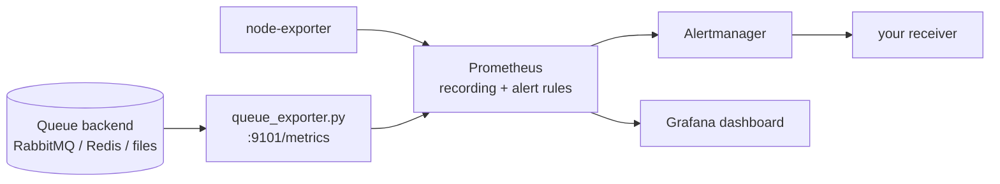

# queue-saturation-observability

[](https://github.com/Walaskien/queue-saturation-observability/actions/workflows/ci.yml)

Monitoring for the case where a message queue falls behind while the servers look healthy.

A queue of documents, jobs or events can back up because consumers are blocked on a database lock, a slow downstream call or a crashed worker. CPU and RAM graphs stay green, so host-level alerts say nothing, while users wait for their documents. This repository measures the queue itself and tells you whether the cause is a **processing bottleneck** or a **shortage of host resources**.

It contains:

- a small Prometheus exporter (Python, standard library only) with adapters for **RabbitMQ** (management API), **Redis lists**, and a **spool directory** of files; plus a simulated queue for trying it out;
- Prometheus recording and alerting rules, covered by `promtool` unit tests;
- Alertmanager config skeleton, a Grafana dashboard provisioned from JSON, a [runbook](docs/runbook.md) (symptom, check, action), and a write-up on [telling a queue bottleneck from host saturation](docs/bottleneck-vs-host.md);
- a Docker Compose stack (Prometheus, Alertmanager, Grafana, node-exporter, exporter) to see all of it working.

This is a reference implementation, not a product used by customers. Review thresholds and credentials before using it on your own systems.

## How it works



Metrics (a metric is left out when the backend cannot provide it):

| Metric | RabbitMQ | Redis list | Files | Simulator |
|---|---|---|---|---|
| `queue_backlog_messages` | yes (ready + unacked) | yes | yes | yes |
| `queue_oldest_message_age_seconds` | no | no | yes (file mtime) | yes |
| `queue_enqueued_total` / `queue_processed_total` | yes (publish / ack) | no | no | yes |
| `queue_stalled_seconds` (backlog, no progress) | yes | no | no | yes |
| `queue_consumers` | yes | no | no | yes |
| `queue_source_up` | yes | yes | yes | yes |

Alerts (`prometheus/rules/alerts.yml`):

- `QueueBacklogGrowingHostHealthy`: backlog grows, CPU < 80% and memory < 90%. Look at consumers, locks, downstream.
- `QueueBacklogGrowingHostBusy`: backlog grows and the host is saturated. Look at the host.
- `QueueOldestMessageTooOld`, `QueueProcessingStalled`, `QueueConsumersDown`, `QueueExporterDown`.

## Use it on your own queue

Run the exporter next to your broker (Python 3.9+, no dependencies):

```console
# RabbitMQ (rabbitmq_management plugin, user with the "monitoring" tag)
RABBITMQ_USER=monitor RABBITMQ_PASSWORD=... \
  python3 exporter/queue_exporter.py --source rabbitmq --queue docs.in \
  --rabbitmq-url http://rabbit.example.internal:15672 --rabbitmq-vhost /

# Redis list
REDIS_PASSWORD=... python3 exporter/queue_exporter.py --source redis --queue docs:pending --redis-host 10.0.0.5

# Directory of files waiting to be imported
python3 exporter/queue_exporter.py --source file --queue /var/spool/docs --file-suffix .xml
```

Then add a scrape job pointing at `:9101` to your Prometheus, copy `prometheus/rules/*.yml`, import `grafana/dashboards/queue-saturation.json`, and set the thresholds in `alerts.yml` to your real latency target. The host-resource part of the alerts needs `node_exporter` metrics from the consumer hosts.

## Try the demo stack

Needs Docker with Compose.

```console
make up            # build and start everything with the simulated queue
make demo-flood    # producers 6x faster than consumers
make demo-stall    # consumers stop
make demo-recover  # more consumers
make alerts        # currently firing alerts
make down
```

Grafana: http://localhost:3000 (anonymous viewer; admin/admin is a demo password, change it for anything else). Prometheus: :9090, Alertmanager: :9093.

## Verified

Run on macOS (Colima, Docker 29), Python 3.9.6:

| Check | Result |
|---|---|
| `pytest -q` (exporter, all adapters) | 13 passed |
| `ruff check .` | all checks passed |
| `promtool check rules` (recording + alerts), `check config` | success, 12 rules (6 recording, 6 alerts) |
| `promtool test rules prometheus/tests.yml` | success (healthy host, busy host, healthy queue, dead consumers, stalled) |
| `amtool check-config` | valid, 1 receiver |
| `docker-compose config` | valid (compose v1.29 in a venv; CI uses `docker compose`) |
| Demo stack, run end to end | all targets up; after `flood` (45 msg/s in, 7.5 out) `ALERTS` showed `QueueBacklogGrowingHostHealthy` with host CPU at about 6%; after `stall` Alertmanager held `QueueOldestMessageTooOld`, `QueueConsumersDown` and the backlog alert; Grafana provisioned the dashboard (found via `/api/search`) |
| RabbitMQ adapter against a real `rabbitmq:3.13-management` container | exported backlog 5, consumers 0, enqueued 5 for a queue with 5 published messages |
| GitHub Actions (`ci`, run 42587313095, commit "Translate docs to English") | success: `ruff` and `pytest` on Python 3.9 and 3.12; `promtool` check and unit tests, `amtool`, `docker compose config` |
| Redis adapter against a real `redis:7` container | backlog 7 after 7 `RPUSH`, 6 after one `LPOP` |
| File adapter on a real directory | 3 `.xml` files counted, oldest age taken from the oldest file's mtime |
| Latest exporter in the full demo stack | after `stall` (consumers 0): `QueueOldestMessageTooOld`, `QueueConsumersDown`, `QueueProcessingStalled` and the backlog alert were firing; after stopping the exporter container `QueueExporterDown` fired |

Not verified: the dashboard visually (provisioning confirmed through the API only), the Redis `AUTH` path against a real server, and any real production workload.

## Limits

- Thresholds are starting points. `for:` durations in the rules are short so the demo reacts in seconds; raise them for noisy real queues.
- RabbitMQ: one queue per exporter; no age of the oldest message (the API does not give it), so use `QueueProcessingStalled`.
- Redis lists: backlog only; no processing rate or age.
- The simulator's `/control` endpoint is unauthenticated and exists only with `--source sim`.
- Host thresholds use the busiest host in Prometheus (`max`). Filter by `instance` if consumers live on one host.
- Alertmanager has an empty receiver on purpose (no secrets in the repo).

## Repository layout

```
exporter/    queue_exporter.py, sources.py (adapters), loadgen.py, Dockerfile
prometheus/  prometheus.yml, rules/ (recording, alerts), tests.yml (promtool unit tests)
alertmanager/, grafana/   configs and provisioned dashboard
docs/        runbook.md, bottleneck-vs-host.md
tests/       pytest for the exporter and adapters
```

## Related

- [ansible-linux-baseline](https://github.com/Walaskien/ansible-linux-baseline): installs node_exporter on the consumer hosts, which the host-resource alerts here need.
- [single-node-k8s-platform](https://github.com/Walaskien/single-node-k8s-platform): another stack with a CI-verified end-to-end check.
